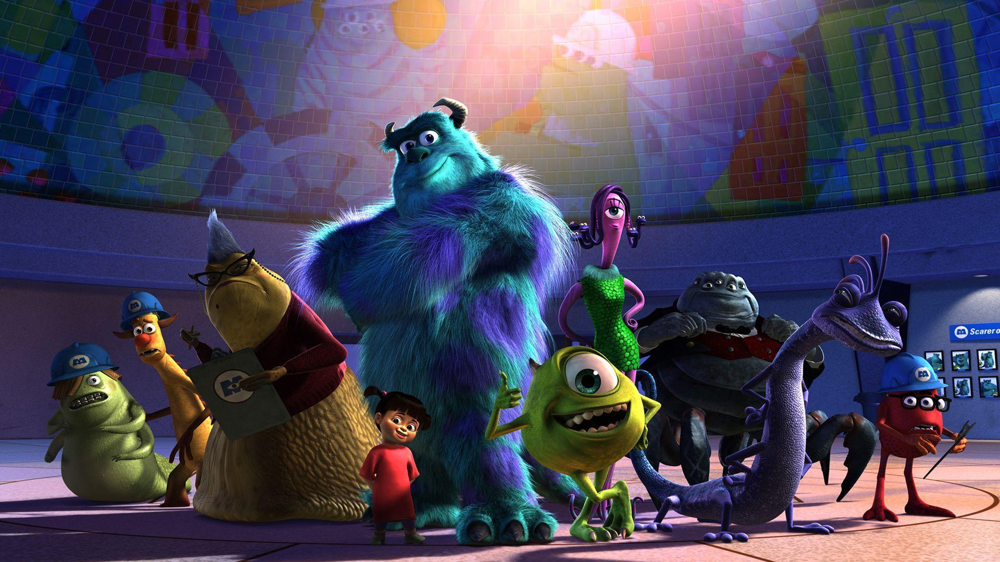
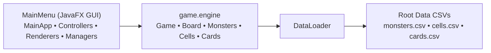

<p align="center">
  
</p>

<h1 align="center">DoorDasH — Scare vs. Laugh Touchdown</h1>

<p align="center">
  A competitive, <em>Monsters, Inc.</em>-inspired desktop strategy board game built in Java &amp; JavaFX.
</p>

<p align="center">
  <a href="https://github.com/AhmedFouad15/Door_Dash/actions/workflows/ci.yml">
    
  </a>
  
  
  
  
</p>

---

## Table of Contents

- [Overview](#overview)
- [Features](#features)
- [Game Rules & Mechanics](#game-rules--mechanics)
- [Monster Archetypes & Roster](#monster-archetypes--roster)
- [Mystery Card Deck](#mystery-card-deck)
- [Controls & Keyboard Shortcuts](#controls--keyboard-shortcuts)
- [Architecture & Project Structure](#architecture--project-structure)
- [Getting Started](#getting-started)
- [Customizing Game Data](#customizing-game-data)
- [Contributing & Contributors](#contributing--contributors)

---

## Overview

**DoorDasH** pits two rival roles—**Scarer** and **Laugher**—against each other in a race across a 100-cell Monstropolis energy floor. Starting at cell `0`, players roll the dice, navigate doors, conveyor belts, contamination socks, mystery cards, and stationed monsters, and manage their energy reserves to reach the finish line.

Reaching the end of the board alone is not enough: **victory requires reaching cell `99` while holding at least `1000` energy.**

<p align="center">
  
</p>

---

## Features

- **1-Player & 2-Player Modes:** Play solo against an automated computer opponent or locally with two players and custom display names.
- **Role-Based Strategy (`SCARER` vs. `LAUGHER`):** Pick your faction during setup; your monster is drawn from your chosen role and paired against a rival from the opposing role, while the remaining 6 monsters are stationed across the board.
- **4 Distinct Monster Archetypes:** Each archetype (`Dasher`, `Dynamo`, `MultiTasker`, `Schemer`) features its own passive modifier and a signature `500`-energy Power-Up.
- **100-Cell Snake Board (`10 × 10`):** Rendered in a classic boustrophedon (zig-zag) path from bottom-left (`0`) to top-left (`99`) with glowing transport links connecting Conveyor Belts and Contamination Socks.
- **Interactive JavaFX Presentation:**
  - Dynamic camera zoom & pan (`1.45x`) tracking monster movement and special events
  - Animated dice roll display, floating energy gain/damage indicators, and damage shake effects
  - Interactive click-to-flip Mystery Card reveal modal
  - Custom animated sequences for Conveyor Belt teleport portals, CDA Contamination Sock cleanups, and Door activations
  - Looping soundtrack and event-specific sound effects (`AudioClip` & `MediaPlayer`)
- **Live Match HUD:** Real-time Player & Opponent status cards, `25`-card deck counter, scrollable Action Log, and a Stationed Monsters inspector window.

---

## Game Rules & Mechanics

### Objective & Win Condition
To win a match, a monster must satisfy **both** conditions simultaneously:
1. Finish on **Cell `99`** (`Constants.WINNING_POSITION`)
2. Hold at least **`1000` Energy** (`Constants.WINNING_ENERGY`)

- Movement wraps modulo `100` (`position % 100`), so overshooting cell `99` loops back to the start of the board.
- A monster **cannot** end its movement on the cell currently occupied by its opponent (`InvalidMoveException`).

### Turn Flow
1. **Optional Power-Up:** If the active monster has at least `500` energy (`Constants.POWERUP_COST`), they may activate their Power-Up before rolling.
2. **Roll Dice:** Roll a 6-sided die (`1–6`). Frozen monsters skip their turn and clear their freeze status.
3. **Move:** Advance along the board according to the roll and the monster's movement multiplier (`Dasher`, `MultiTasker`, or standard `1x`).
4. **Resolve Landing Cell:** Trigger the effect of the landed cell (Door, Card, Conveyor Belt, Contamination Sock, or Stationed Monster).
5. **Pass Turn:** Confusion counters decrement if active, and control passes to the opponent.

### Board Spaces

The 100 cells (`0`–`99`) are populated from [`cells.csv`](cells.csv) and [`Constants.java`](src/game/engine/Constants.java):

| Cell Type | Count | Board Indices | Effect |
| :--- | :---: | :--- | :--- |
| **Door Cell** (`DoorCell`) | 50 | All odd indices (`1, 3, ..., 99`) | Matching-role monsters gain the door's energy (`85–125`) and boost all stationed allies of the same role. Opposing-role monsters lose that energy (blockable by a Shield). Once triggered, the door becomes **Used**. |
| **Card Cell** (`CardCell`) | 10 | `4, 12, 28, 36, 48, 56, 60, 76, 86, 90` | Draws the top card from the shuffled 25-card deck (automatically reloads & reshuffles when empty). |
| **Monster Cell** (`MonsterCell`) | 6 | `2, 18, 34, 54, 82, 88` | Hosts one of the 6 unchosen monsters. Landing on an **ally** triggers your Power-Up for free; landing on a **rival** with less energy than you swaps the energy difference (`diff`) to the stationed monster (blockable by a Shield). |
| **Conveyor Belt** (`ConveyorBelt`) | 5 | `6, 22, 44, 52, 66` | Propels the monster forward (`+2`, `+10`, `+11`, `+15`, or `+25` cells). |
| **Contamination Sock** (`ContaminationSock`) | 5 | `32, 42, 74, 84, 98` | Pulls the monster backward (`-6`, `-10`, `-12`, `-14`, or `-22` cells) and inflicts a **`-100` energy** slip penalty (blockable by a Shield). |
| **Normal Rest Corridor** (`Cell`) | 24 | Remaining even indices | Safe space with no special effect. |

---

## Monster Archetypes & Roster

### Archetypes

| Archetype | Badge | Passive Ability | Power-Up (`500` Energy) |
| :--- | :---: | :--- | :--- |
| **Dasher** | `x2` | **Lightning Movement:** Doubles all dice rolls (`2x`). | **Momentum Rush:** Triples dice rolls (`3x`) for `3` turns. |
| **Dynamo** | `2E` | **Energy Amplification:** Doubles all energy gains and losses (`2x`). | **Energy Freeze:** Freezes the opponent, forcing them to skip their next turn. |
| **MultiTasker** | `+200` | **Movement-Energy Tradeoff:** Halves dice movement (`roll / 2`), but adds `+200` bonus on energy updates. | **Focus Mode:** Restores normal (`1x`) dice movement for `2` turns. |
| **Schemer** | `+10` | **Energy Manipulation:** Adds a `+10` bonus on energy updates. | **Chain Attack:** Steals up to `10` energy from the opponent and every stationed monster on the board (ignores shields). |

### Character Roster (`monsters.csv`)

| Monster | Archetype | Base Role | Starting Energy | Description |
| :--- | :--- | :--- | :---: | :--- |
| **James P. Sullivan** | `Dynamo` | `SCARER` | `300` | The top scarer |
| **Mike Wazowski** | `Dasher` | `LAUGHER` | `100` | Fast and funny |
| **Randall Boggs** | `Schemer` | `SCARER` | `20` | Sneaky and cunning |
| **Celia Mae** | `MultiTasker` | `LAUGHER` | `50` | Organized receptionist |
| **Roz** | `MultiTasker` | `SCARER` | `100` | Always watching |
| **Fungus** | `Dasher` | `LAUGHER` | `50` | Timid assistant |
| **Henry J. Waternoose** | `Schemer` | `SCARER` | `70` | Witty and strategic CEO |
| **Yeti** | `Dynamo` | `LAUGHER` | `100` | Banished snow monster |

---

## Mystery Card Deck (`cards.csv`)

The deck contains **25 cards** expanded by rarity weight:

| Card Name | Card Class | Copies | Alignment | Effect |
| :--- | :--- | :---: | :---: | :--- |
| **Position Swap** | `SwapperCard` | `5` | Lucky | Swaps board positions with the opponent if you are behind them. |
| **Super Shield** | `ShieldCard` | `5` | Lucky | Grants a one-use shield that blocks the next negative energy effect (and removes an opponent's active shield). |
| **Small Snatcher** | `EnergyStealCard` | `3` | Lucky | Steals `50` energy from the opponent (blocked if shielded). |
| **Sneaky Thief** | `EnergyStealCard` | `2` | Lucky | Steals `100` energy from the opponent (blocked if shielded). |
| **2319 Alert** | `StartOverCard` | `3` | Lucky | Sends the opponent back to cell `0`. |
| **Contamination Code** | `StartOverCard` | `2` | Unlucky | Sends the active player back to cell `0`. |
| **Mind Scramble** | `ConfusionCard` | `3` | Unlucky | Swaps both players' active roles and marks them confused for `2` turns. |
| **Total Confusion** | `ConfusionCard` | `2` | Unlucky | Swaps both players' active roles and marks them confused for `3` turns. |

---

## Controls & Keyboard Shortcuts

| Key | Action |
| :---: | :--- |
| **`Space`** / **`R`** | Roll the dice |
| **`P`** | Activate your monster's Power-Up (`>= 500` energy required) |
| **`S`** | Open the **Stationed Monsters** details panel |
| **`M`** | Open the **Menu / Restart Game** confirmation dialog |

---

## Architecture & Project Structure



```text
Door_Dash/
├── .github/
│   ├── ISSUE_TEMPLATE/                   # Bug report & feature request templates
│   └── workflows/ci.yml                  # GitHub Actions Maven build & test workflow
├── pom.xml                               # Maven build, JavaFX 26 & JUnit 5 configuration
├── cards.csv                             # Card definitions, rarity weights, and parameters
├── cells.csv                             # 50 Door cells + 5 Conveyor Belts + 5 Contamination Socks
├── monsters.csv                          # Playable & stationed monster definitions
├── CONTRIBUTING.md                       # Contribution & developer guidelines
├── FInally game.iml                      # IntelliJ IDEA module definition
├── Names&Tut&ID.txt                      # Course team roster
├── src/
│   ├── game/engine/                      # Pure-Java game simulation & domain model
│   │   ├── Board.java                    # 10x10 board initialization, movement, card deck
│   │   ├── Constants.java                # Board dimensions, special cell indices, balance constants
│   │   ├── Game.java                     # Turn lifecycle, power-ups, win condition
│   │   ├── Role.java                     # SCARER / LAUGHER enum
│   │   ├── cards/                        # Card & 5 concrete card implementations
│   │   ├── cells/                        # Cell, DoorCell, CardCell, MonsterCell, TransportCell, ...
│   │   ├── dataloader/DataLoader.java    # CSV parsers for cards, cells, and monsters
│   │   ├── exceptions/                   # GameActionException hierarchy & InvalidCSVFormat
│   │   ├── interfaces/CanisterModifier.java
│   │   └── monsters/                     # Monster base class, Dasher, Dynamo, MultiTasker, Schemer
│   └── MainMenu/                         # JavaFX GUI, FXML views, animations, audio & assets
│       ├── MainApp.java                  # JavaFX Application entry point
│       ├── MainMenu.fxml / MainMenuController.java
│       ├── Instructions.fxml / InstructionsController.java
│       ├── GameScreen.fxml / GameController.java
│       ├── GameSetupWindow.java          # 1P/2P mode, player names, rules & role picker overlay
│       ├── WinWindow.java                # Victory / Game Over modal
│       ├── BoardRenderer.java            # Snake-grid board rendering & step/glide transitions
│       ├── CellFactory.java              # Styled cell tiles, icons, hover glows & animations
│       ├── MonsterRenderer.java          # Monster tokens, type badges & status overlays
│       ├── AnimationManager.java         # Dice animation, card flip popup, camera & shake effects
│       ├── NotificationManager.java      # Floating combat/energy text notifications
│       ├── SceneManager.java             # Smooth fade transitions between FXML scenes
│       ├── SoundManager.java             # Sound effects & voice/event audio clips
│       ├── menu.css                      # JavaFX CSS theme
│       └── assets/                       # Audio (.mp3/.wav/.m4a), images (.png/.jpg/.webp), video (.mp4)
└── test/
    └── game/engine/GameEngineTest.java   # JUnit 5 engine unit tests
```

---

## Getting Started

### Prerequisites

- **Java Development Kit (JDK) 25**
- **Maven 3.9+** (recommended, automatically resolves JavaFX 26.0.1 and JUnit 5), **or** a standalone **JavaFX 26 SDK** for IntelliJ / manual CLI runs

> **Important:** `DataLoader` reads `cards.csv`, `cells.csv`, and `monsters.csv` using relative file paths, so the **working directory must be the repository root** (`Door_Dash/`) when launching the application.

### Option 1: Run with Maven (Recommended)

```bash
git clone https://github.com/AhmedFouad15/Door_Dash.git
cd Door_Dash

# Launch the game
mvn javafx:run

# Run the engine test suite
mvn test
```

### Option 2: Run in IntelliJ IDEA

1. Clone the repository and open `Door_Dash/` in **IntelliJ IDEA**.
2. Configure the **Project SDK** to **JDK 25** (`File -> Project Structure -> Project`).
3. Either import `pom.xml` as a Maven project (recommended), or point the `lib` library (`File -> Project Structure -> Libraries`) to your local `<path-to-javafx-sdk>/lib` folder.
4. Run `MainMenu.MainApp` with working directory set to the repository root (`Door_Dash/`).

### Option 3: Manual `javac` & `java` CLI (Without Maven)

#### Windows (PowerShell)

```powershell
$JAVAFX_LIB = "C:\path\to\javafx-sdk-26.0.1\lib"
New-Item -ItemType Directory -Force -Path out | Out-Null

$sources = Get-ChildItem -Path src -Recurse -Filter *.java | ForEach-Object { $_.FullName }
javac --module-path $JAVAFX_LIB --add-modules javafx.controls,javafx.fxml,javafx.media -d out $sources

Copy-Item -Path src\MainMenu\*.fxml, src\MainMenu\*.css -Destination out\MainMenu\ -Force
Copy-Item -Path src\MainMenu\assets -Destination out\MainMenu\assets -Recurse -Force

java --module-path $JAVAFX_LIB --add-modules javafx.controls,javafx.fxml,javafx.media -cp out MainMenu.MainApp
```

#### macOS / Linux (Bash)

```bash
JAVAFX_LIB="/path/to/javafx-sdk-26.0.1/lib"

mkdir -p out
javac --module-path "$JAVAFX_LIB" --add-modules javafx.controls,javafx.fxml,javafx.media -d out $(find src -name "*.java")
cp src/MainMenu/*.fxml src/MainMenu/*.css out/MainMenu/
cp -r src/MainMenu/assets out/MainMenu/

java --module-path "$JAVAFX_LIB" --add-modules javafx.controls,javafx.fxml,javafx.media -cp out MainMenu.MainApp
```

---

## Customizing Game Data

You can tune game balance or add custom content directly in the root CSV files without recompiling:

- **`monsters.csv`:** `ARCHETYPE,Name,Description,ROLE,StartingEnergy` (`DYNAMO | DASHER | MULTITASKER | SCHEMER`, `SCARER | LAUGHER`)
- **`cells.csv`:**
  - Doors (3 columns): `CellName,ROLE,Energy`
  - Transports (2 columns): `CellName,Offset` (positive offset creates a `ConveyorBelt`; negative offset creates a `ContaminationSock`)
- **`cards.csv`:** `CARD_TYPE,Name,Description,Rarity[,ExtraParam]` (`SWAPPER`, `SHIELD`, `ENERGYSTEAL`, `STARTOVER`, `CONFUSION`)

---

## Contributing & Contributors

Contributions are welcome! See [CONTRIBUTING.md](CONTRIBUTING.md) for guidelines on local setup, architecture boundaries, and running tests.

### Authors

- **Ahmed Fouad Eid El-Dmrdash** ([@AhmedFouad15](https://github.com/AhmedFouad15))
- **Mariam Yasser Abd Al Salam**
- **Maria Guirguis Samir**
- **Mina Salama Fayez Elisa**

> **Disclaimer:** *DoorDasH* is an educational student project inspired by *Monsters, Inc.* Characters, names, and themed media assets are used strictly for non-commercial learning and portfolio purposes.
